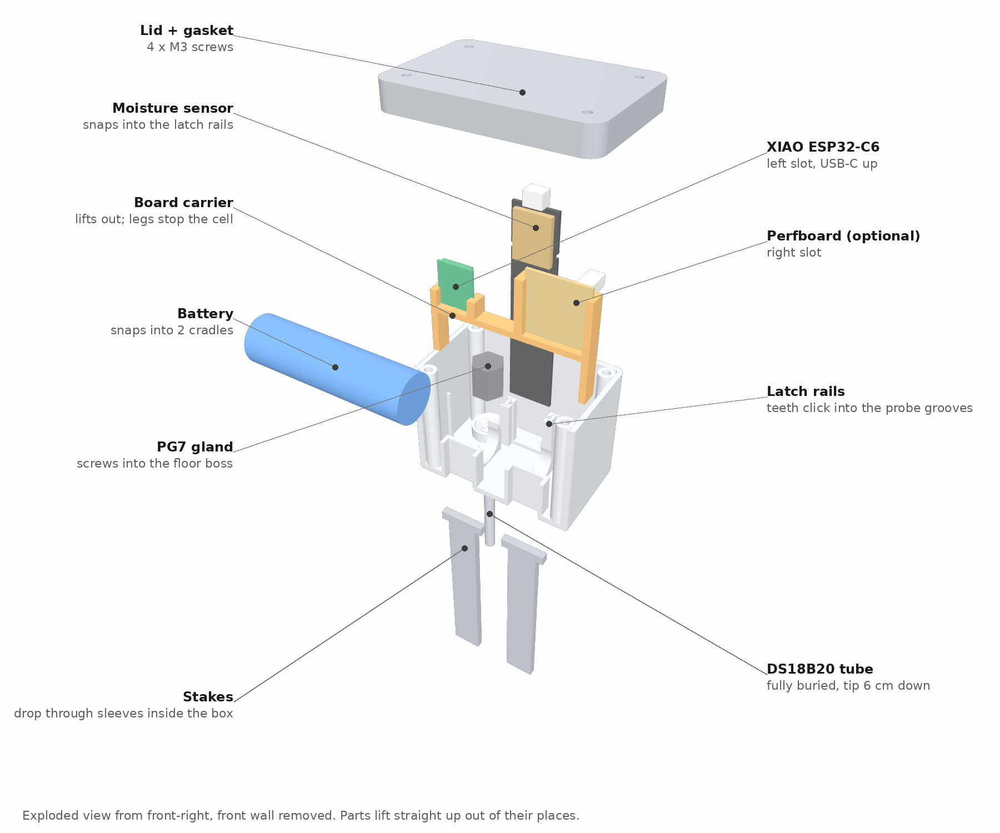

# cheap-esphome-soil-sensor

A battery-powered soil moisture and soil temperature sensor that talks to Home Assistant over **Thread**. It's built from cheap, easy-to-find parts: a Seeed XIAO ESP32-C6, a capacitive soil moisture sensor v2.0, a DS18B20 waterproof probe and a wrapped 18650 cell, in a 3D-printed ASA enclosure that stakes into the ground.

The sensor wakes every 15 minutes, joins Thread, reports to Home Assistant through the ESPHome native API, and goes back into deep sleep.

## Features

- **Thread, no Wi-Fi.** ESPHome's OpenThread support (minimal end device) through your existing border router.
- **Deep sleep between reports.** The moisture probe is powered from a GPIO only while it's being read, so it adds nothing to the sleep current.
- **Calibration from Home Assistant.** Dry and wet points are number entities on the device page, stored in flash. You never reflash to recalibrate.
- **Battery protection.** Below 3.40 V the sensor wakes once a day; below 3.30 V, once a week. A forgotten charge can't run the cell flat.
- **Stay-awake toggle.** One Home Assistant helper keeps every sensor awake for OTA updates or live logs. Updates are protected from the sleep timer while they run.
- **Soil temperature at depth.** The DS18B20's steel tube is buried whole, next to the moisture probe and at the same depth, and its cable enters through a PG7 gland.
- **Compact and printable without supports.** An 83 × 53 mm box with a gasketed lid, snap-in battery cradles, a lift-out carrier for the XIAO and an optional perfboard, rails with snap latches that lock the probe at the right depth, and two stakes in sleeves inside the box.

## Repository layout

| Path | What's in it |
| --- | --- |
| [`firmware/soil-sensor.yaml`](firmware/soil-sensor.yaml) | ESPHome config |
| [`firmware/secrets.example.yaml`](firmware/secrets.example.yaml) | The two secrets it needs |
| [`enclosure/soil_enclosure.py`](enclosure/soil_enclosure.py) | Parametric enclosure model (Python, manifold3d) |
| [`enclosure/stl/`](enclosure/stl) | Ready-to-print STLs |
| [`docs/build.md`](docs/build.md) | Bill of materials, printing and assembly |
| [`docs/soldering.md`](docs/soldering.md) | Solder map, step-by-step soldering and bench tests |
| [`docs/soldering-perfboard.md`](docs/soldering-perfboard.md) | Alternative: divider and battery junction on a small perfboard |
| [`docs/firmware.md`](docs/firmware.md) | Flashing, Home Assistant setup, calibration, OTA, troubleshooting |

## Quick start

1. **Print** the parts in ASA: [docs/build.md](docs/build.md#printing).
2. **Solder** the XIAO: about eight joints, no extra board. See [docs/soldering.md](docs/soldering.md), or [the perfboard option](docs/soldering-perfboard.md) if you'd rather not dead-bug the divider.
3. **Flash** the firmware over USB the first time, then add the device in Home Assistant and create the stay-awake helper. See [docs/firmware.md](docs/firmware.md).
4. **Calibrate** in air and in water from the device page in Home Assistant.
5. **Assemble and install:** press the box into the soil until the floor sits flat, with the stakes through their sleeves.

## Status

Working on the bench with one unit. Not yet proven in the field.

- **Battery life:** not measured yet. Expect months on one charge with 15-minute reports.
- **Probe groove position:** the dimensions locating the probe's side grooves come from the product photo. Measure your probe before printing the box (see `GROOVE_FROM_TOP` in the enclosure script): the latches click into those grooves.
- **First minute after an update:** don't open USB serial logs. The USB reset makes the bootloader roll back to the previous build.
- **Quick restarts on the bench:** after several resets in a row, Home Assistant can lose the sensor for a few minutes while the Thread network catches up. Normal 15-minute wakes have been fine.

## License

[MIT](LICENSE)
