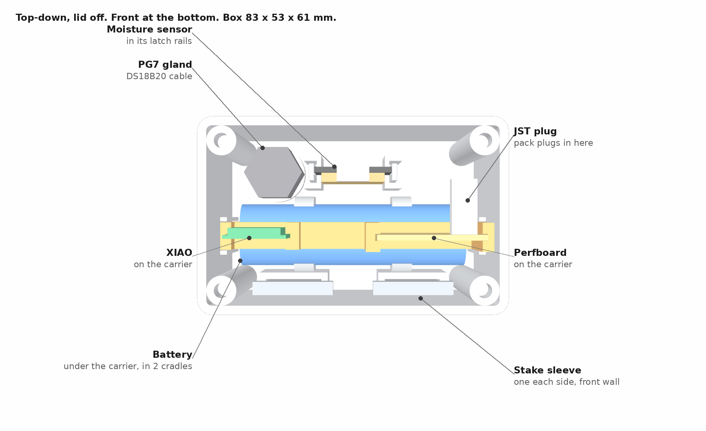
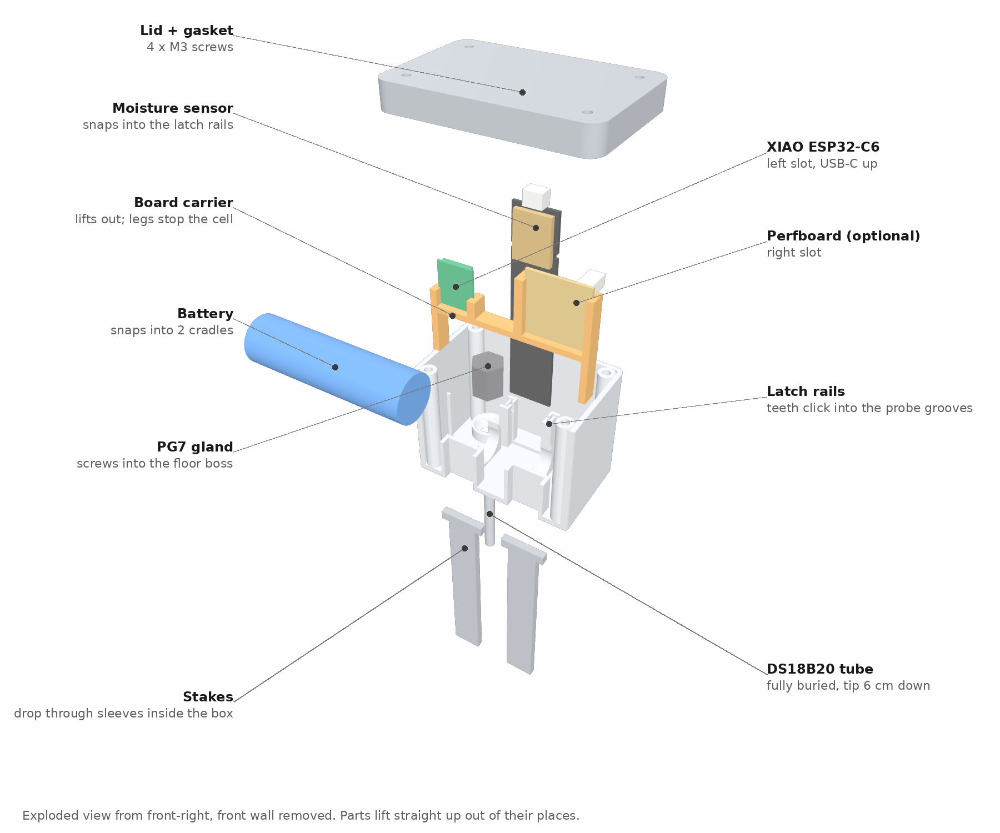
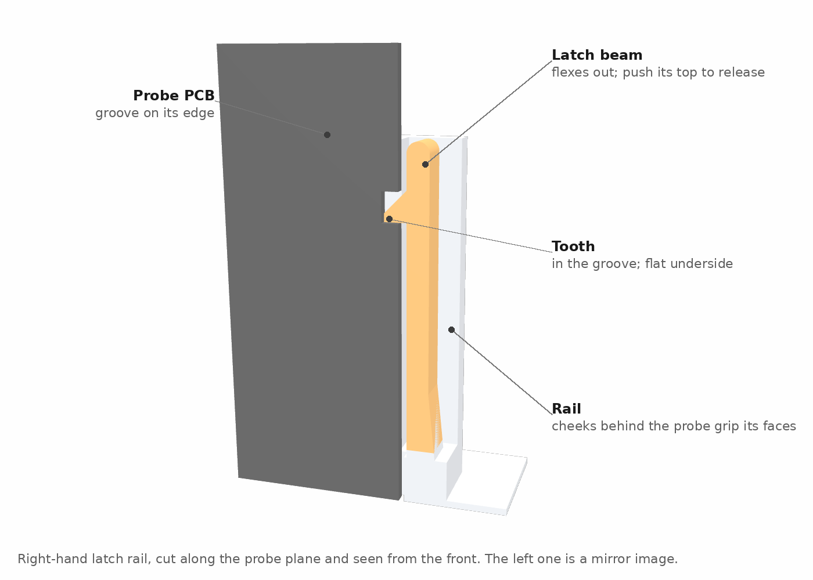

# Build guide

## Bill of materials

Quantities are per sensor.

| Item | Qty | Notes |
| --- | --- | --- |
| Seeed XIAO ESP32-C6 | 1 | No headers. The wires solder straight to the pads. |
| Capacitive soil moisture sensor v2.0 | 1 | Check the timer chip: a TLC555 works at 3.3 V; NE555 versions are unreliable. |
| DS18B20 waterproof probe, 6 × 50 mm stainless tube | 1 | Usually sold with a 1 m cable. Coil the spare inside the box. |
| PG7 nylon cable gland (3–6.5 mm cable) | 1 | Screws into a threaded boss in the floor. No locknut needed. |
| 3.7 V wrapped 18650 pack with JST PH leads (~19 mm × 69 mm) | 1 | Snaps into the cradles |
| JST PH 2.0 2-pin pigtail (mating) | 1 | Goes on the XIAO's BAT pads (or the perfboard), so the pack unplugs |
| 1 MΩ resistor | 2 | Battery-voltage divider |
| 100 nF ceramic capacitor | 1 | Across the lower divider resistor. Needed because 1 MΩ is too weak a source for the ADC on its own. |
| 4.7 kΩ resistor | 1 | DS18B20 pull-up. **Check it's kΩ, not Ω:** yellow-violet-black-*brown* on a 5-band resistor. |
| 26–28 AWG silicone wire | ~30 cm | |
| JST-PH 2-pin header, top-entry (B2B-PH-K-S) | optional | Replaces the pigtail on the perfboard version: the pack plugs straight into the board |
| Perfboard, ~30 × 30 mm, 2.54 mm pitch | optional | Holds the divider and battery junction instead of dead-bugging them on the XIAO. See [soldering-perfboard.md](soldering-perfboard.md). |
| M3 heat-set insert (4.0 mm hole) | 4 | Lid screws |
| M3 × 10 pan-head screw + nylon washer | 4 | |
| Gasket: printed TPU or 2 mm silicone cord | 1 | About 300 mm of cord |
| Neutral-cure silicone | — | Seals the probe slot in the floor |
| Conformal coat or clear nail polish | — | Probe edges and component area |
| 6 mm rod or long screwdriver | — | For installing only: makes the pilot hole for the DS18B20 tube |
| M12 breather vent | optional | Only if condensation shows up. Set `VENT_D = 12.4`. |

## Printing

Print everything in **ASA**, except the optional TPU gasket. ASA is UV-stable and stays stiff in a hot box in full sun. PETG will last a season or two, but avoid PLA because it softens around 55–60 °C. Choose a light colour if you can: a dark box runs much hotter in the sun, which is bad for the cell and skews the soil temperature underneath.

None of the parts need supports.

| Part | Orientation | Notes |
| --- | --- | --- |
| `box.stl` | Floor on the bed | 6 perimeters (2.4 mm walls), 15–20% infill, 5 mm brim. 83 × 53 × 61 mm. |
| `lid.stl` | Top face on the bed (already flipped) | 5 mm brim |
| `latch_test.stl` | Floor on the bed | Optional, about 15 minutes. The floor around the probe slot with both latch rails, so you can check the click, the depth and the release before printing the box. |
| `board_carrier.stl` | Back face on the bed (already laid flat) | 4+ perimeters. Holds the XIAO and the perfboard over the battery. |
| `stake.stl` | Flat | Print 2. 100% infill or 6+ perimeters. |
| `gasket_tpu.stl` | Flat | TPU, optional |

On a Bambu X1C, print in an enclosed chamber with little or no part cooling, the bed at 100–110 °C, and the nozzle at 240–260 °C. 0.2 mm layers are fine, even for the 1.27 mm-pitch gland thread.

**Fit checks after the first print:**

- **PG7 gland:** screw it into its floor boss. If it binds, raise `PG7_CLEAR` by 0.1.
- **Battery cradles:** press the cell in. If it's too stiff, set `CRADLE_OPEN` to 18.0; if it's loose, 17.2.
- **Probe latches:** print `latch_test.stl` first if you can, then push the probe down through the rails. Both latches should click into its side grooves with the floor 13 mm below the warning line. The groove position comes from the product photo, so measure yours and set `GROOVE_FROM_TOP` if needed. If the probe rocks in the rails, lower `RAIL_SLOT_CLEAR`; if the latches are too stiff, lower `BEAM_T` to 1.4. Each latch beam should move freely: if one has printed fused to its rail, raise `LATCH_SLIT`.
- **Board carrier:** slide the XIAO and the perfboard into their slots. The slots assume a 1.0 mm XIAO PCB and a 30 × 30 × 1.6 mm perfboard, so measure yours and adjust `XIAO_PCB_T`, `PERF_W`, `PERF_H` and `PERF_T`. The carrier's legs should drop into the channels on the end walls without forcing.

Every dimension is a parameter at the top of [`enclosure/soil_enclosure.py`](../enclosure/soil_enclosure.py). After changing one, regenerate the STLs:

```sh
pip install manifold3d trimesh numpy
python3 enclosure/soil_enclosure.py   # writes enclosure/stl/
```

## Layout





- **Battery:** lies across the front of the box in two snap cradles.
- **Board carrier:** stands over the battery. Its legs drop into channels on the end walls and also stop the cell sliding sideways. The XIAO stands in the left slot (USB-C up, wired top side toward the probe). The optional perfboard stands in the right slot, component side toward the probe; with the dead-bug build that slot stays empty. Lift the carrier out, boards and all, to get at the cell.
- **Moisture probe:** stands edge-on behind the battery and passes through a slot in the floor. Two rails grip its edges from the floor up, so it can't rock, and a snap latch in each rail clicks into its side grooves. That sets the floor 13 mm below the probe's "never bury past this" line, inside the maker's recommended band.
- **DS18B20:** the tube is buried 24 mm to the left of the probe centre, in the same plane as the probe's board. Its tip is 6 cm down.
- **Stakes:** two blade stakes drop through sealed sleeves along the inside of the front wall.



The latch tooth has a flat underside, so soil pushing back on the probe while you press the box in can't push it up. Its top is sloped, so the probe snaps in from above. To take the probe out, push the tops of both latch beams outward and lift.

## Assembly

1. **Inserts and gland.** Press the four M3 heat-set inserts into the corner bosses. Screw the PG7 gland body into the floor boss from inside.
2. **Coat the probe.** Paint the cut PCB edges along the whole probe, and the component area, with conformal coat or nail polish. Leave the connector clean.
3. **Solder the XIAO** following [soldering.md](soldering.md), or [soldering-perfboard.md](soldering-perfboard.md) for the perfboard option. Before soldering the DS18B20, feed its cable up through the gland body, seal insert and cap: the steel tube won't fit through afterwards.
4. **Flash and bench test.** See [firmware.md](firmware.md).
5. **Fit the probe.** With the components facing the battery side, push it down between the latch rails and through the floor slot until both latches click into its grooves.
6. **Board carrier.** Slide the XIAO into the left slot (USB-C up, wired side toward the probe) and, if you built one, the perfboard into the right slot (component side toward the probe).
7. **Mark the DS18B20 depth.** With the tube hanging below the floor, set its tip 60 mm below the floor's underside. Mark the cable where it leaves the top of the gland body.
8. **Seal the probe slot** with neutral-cure silicone, inside and out, and let it cure.
9. **Battery.** Press the pack down into the two cradles with its leads along the top.
10. **Carrier in.** Lower the carrier over the cell until its legs bottom out in the end-wall channels, then plug the pack in. Coil the spare DS18B20 cable in the rear-left corner, around the gland.
11. **Install.** With the lid off, unscrew the gland cap and pull the steel tube up into the box through the gland body. Drop a stake through each sleeve from inside and press the box down until the floor sits flat on the soil. Push the 6 mm rod down through the gland body about 6 cm and pull it out. Lower the tube into the hole until the cable mark reaches the gland, then tighten the cap. Firm the soil around the edge of the floor.
12. **Lid.** Seat the gasket, then fit the lid with four M3 × 10 screws and washers. Tighten evenly until the gasket just compresses.
