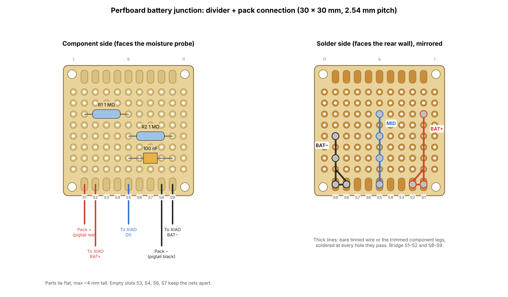

# Soldering guide: perfboard option

This is an alternative to the dead-bug build in [soldering.md](soldering.md). The battery junction and divider move onto a small perfboard that slides into a card guide on the box's rear wall. This leaves the XIAO underside with just the two battery wires and the one-wire pull-up, and the divider is easier to solder, inspect and replace.

The pull-up stays where it is (3V3 to D3 on the XIAO), and the two sensors wire to the XIAO's top side exactly as before.

## What goes where

| Net | Perfboard | Connects to |
| --- | --- | --- |
| BAT+ | Column 2, slots S1 + S2 | S1: pack + (pigtail red). S2: wire to XIAO **BAT+** pad. |
| MID | Column 6, slot S5 | Wire to XIAO **D0** |
| BAT− | Column 10, slots S8 + S9 | S8: pack − (pigtail black). S9: wire to XIAO **BAT−** pad. |

Components (component side, lying flat):

- **R1, 1 MΩ:** column 2 to column 6, row 3
- **R2, 1 MΩ:** column 6 to column 10, row 5
- **100 nF:** column 6 to column 10, row 7. Bend the legs so it lies on its side.

Leave slots S3, S4, S6 and S7 empty. They keep the three nets apart. The top row of slots and the outer columns (1 and 11) aren't used: the rails of the card guide cover the outer 1 mm of each side edge.

The board is assumed to be 30 × 30 × 1.6 mm with 11 × 8 holes at 2.54 mm, and a row of nine slots along the top and bottom edges. If yours is different, set `PERF_W`, `PERF_H` and `PERF_T` in [`enclosure/soil_enclosure.py`](../enclosure/soil_enclosure.py) and regenerate the box.

## How it sits in the box

- **Position:** vertical, against the rear wall, directly behind the moisture probe. The slot pads are at the bottom.
- **Component side:** faces the probe. Keep parts under about 4 mm tall: there's about 5 mm before the probe's connector.
- **Solder side:** faces the wall, with about 4 mm of clearance for the links.
- **Height:** the board's bottom edge rests 24 mm above the floor, above the probe clip. The top 4 mm stands above the rails so you can pull it out.
- **Wire routing:** wires leave the bottom edge and run along the rear wall to the right, toward the XIAO. The pigtail runs from the battery past the right side of the probe.

## Extra parts

- **Perfboard:** about 30 × 30 mm, 2.54 mm pitch, single-sided.
- **Tinned copper wire:** a few cm of bare wire for the solder-side links, or use the trimmed component legs.

Everything else (the resistors, capacitor, pigtail and wire) is the same as the dead-bug build.

## Before you start

The checklist in [soldering.md](soldering.md#before-you-start) still applies. Pay most attention to **battery polarity**: meter the pack through the pigtail and mark the + wire before you cut anything.

## Steps

**Perfboard**

1. **Fit the parts.** Insert R1, R2 and the capacitor from the component side at the holes above. Press them flat to the board and splay the legs on the solder side to hold them.
2. **Solder the legs** at their own holes. Don't trim them yet.
3. **Run the links.** On the solder side, bend each leg down its column toward the bottom edge and solder it at every hole it passes. Use the R1 leg for column 2, an R1 or R2 leg for column 6, and an R2 or capacitor leg for column 10. Where a leg won't reach, continue with tinned wire.
4. **Bring each column into its slot:** column 2 into S1 and S2, column 6 into S5, and column 10 into S8 and S9. Bridge S1–S2 and S8–S9 with a blob of solder or a short piece of wire.
5. **Check the gaps.** Trim the excess legs, then inspect between columns 2, 6 and 10 and across S3/S4 and S6/S7 for solder bridges.

**Wires to the perfboard** (all enter from the component side and solder on the slot pads)

6. **Pigtail:** cut the JST pigtail to about 10 cm, then strip and tin it. Solder red to **S1** and black to **S8**.
7. **XIAO battery leads:** cut two wires about 10 cm long, one red and one black. Solder red to **S2** and black to **S9**.
8. **D0 lead:** cut one wire about 10 cm long, ideally blue or yellow, and solder it to **S5**.
9. **Strain relief:** put a dab of hot glue over the slot joints where the wires leave the board.

**XIAO underside** (board flipped over)

10. **Tin the pads:** add flux, then a small blob of solder on BAT+ and BAT−.
11. **Battery leads:** solder the red wire from S2 to **BAT+** and the black wire from S9 to **BAT−**. Tug each one gently to check it.
12. **Pull-up:** sleeve the legs of the 4.7 kΩ and push them into the 3V3 and D3 holes from below. Bend them over on top to hold it. This is unchanged from the dead-bug build.
13. **Insulate:** lay Kapton tape over the BAT pads.

**XIAO top side** (right way up, USB-C up)

14. **D0:** push the S5 wire into the **D0** hole from the top.
15. **Sensors:** connect the moisture sensor (yellow to D1, red to D2), the DS18B20 (yellow to D3, red to 3V3), and both black wires twisted into GND. This is the same as steps 11–13 of [soldering.md](soldering.md#steps).
16. **Solder** D0, D1, D2, D3, 3V3 and GND, then trim the legs flush.

## Test before closing

**Unpowered, on the perfboard**

- [ ] S1 to S2: continuity. S8 to S9: continuity.
- [ ] S2 to S9 (BAT+ to BAT−): about 2 MΩ, not a short.
- [ ] S5 to S9: up to about 1 MΩ, not 0 and not open. The capacitor charges from the meter, so the reading climbs.
- [ ] S2 to S5: about 1 MΩ.
- [ ] No continuity from S3, S4, S6 or S7 to anything.

**Unpowered, on the XIAO**

- [ ] S2 has continuity to the BAT+ pad, S9 to the BAT− pad, and S5 to D0.
- [ ] 3V3 to D3 reads about 4.7 kΩ.
- [ ] The neighbouring-pin checks from [soldering.md](soldering.md#test-before-closing).

**Powered**

- [ ] With the pack plugged in, the XIAO's BAT+ to BAT− reads 3.7–4.2 V, positive on BAT+.
- [ ] D0 to GND reads about half the pack voltage. It reads a little lower because the meter loads the divider.
- [ ] After flashing, the battery voltage in Home Assistant matches your meter within about 0.05 V.

## Fitting it in the box

1. **Fit the XIAO** in its card guide first.
2. **Slide the perfboard** straight down into the rear-wall rails, component side toward the probe and slots at the bottom, until it bottoms out.
3. **Route the wires** along the rear wall to the right. Run the pigtail from the battery past the right side of the probe, then plug it into the pack.

If the board is loose in the rails, add a strip of tape along each side edge. If it's tight, sand the edges or raise `PERF_SLOT_CLEAR` by 0.1.

## Troubleshooting

| Symptom | Likely cause | Fix |
| --- | --- | --- |
| Battery reads 0 | The S5 to D0 wire is open, or column 6 isn't linked to S5 | Check continuity from S5 to D0, and along column 6 |
| Battery reads about full pack voltage | R2 is open, or column 10 isn't linked to S8/S9 | Check S5 to S9 resistance |
| Board dead on battery, fine on USB | Pigtail reversed, or S1–S2 / S8–S9 not bridged | Check polarity at the XIAO pads and the slot bridges |
| Perfboard won't drop into the rails | Board wider than 30 mm, or parts hanging over the side edges | Measure it and set `PERF_W`, or trim the edges |
