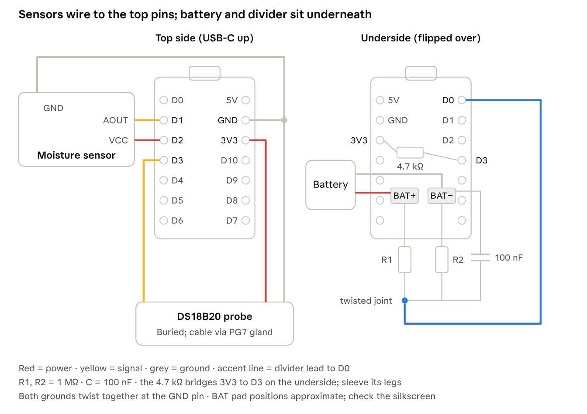

# Soldering guide

Each sensor takes about eight solder joints on a bare XIAO ESP32-C6, with no headers and no extra board. Solder the underside first (battery, divider, pull-up), then the top side (both sensors).

The map spreads the divider out so you can see every joint. On the real board it lies flat against the underside, between the BAT pads and D0, inside the board outline and no more than about 4 mm tall. Leave the bottom pin rows (D4–D9) bare: that's where the card guide grips the board.

## Pin map

| From | XIAO pin | GPIO | Purpose |
| --- | --- | --- | --- |
| Moisture sensor VCC (red) | D2 | GPIO2 | Powers the probe only while reading |
| Moisture sensor AOUT (yellow) | D1 | GPIO1 | Moisture reading (ADC) |
| Moisture sensor GND (black) | GND | — | |
| DS18B20 red | 3V3 | — | Always powered; idles at about 1 µA |
| DS18B20 yellow (data) | D3 | GPIO21 | One-wire bus, with 4.7 kΩ from here to 3V3 |
| DS18B20 black | GND | — | Twist together with the moisture sensor's ground |
| Divider midpoint | D0 | GPIO0 | Battery voltage ÷ 2 (ADC) |
| Pack + / − | BAT+ / BAT− pads (underside) | — | Through the JST PH pigtail |

Divider: BAT+ → 1 MΩ → midpoint → 1 MΩ → BAT−, with the 100 nF capacitor from the midpoint to BAT−. It draws about 2 µA all the time.

## Tools

- **Iron:** fine chisel tip. Run it at 330–340 °C for leaded solder, 350–370 °C for lead-free.
- **Solder and flux:** 0.5–0.8 mm rosin-core solder. Flux helps a lot on the BAT pads.
- **Cutting and stripping:** flush cutters and strippers for 26–28 AWG.
- **Insulation:** 1.5 mm and 3 mm heat-shrink, and Kapton tape.
- **Multimeter.**

## Before you start

- [ ] **Battery polarity.** Plug the pigtail into the pack and meter it, and note which wire is +. Cheap packs and pigtails are often wired opposite ways, and reversing the XIAO's battery input can kill its charger.
- [ ] **Timer chip.** The 8-pin chip on the moisture sensor should be a TLC555 (or a TI 555), not an NE555.
- [ ] **BAT pads.** Find BAT+ and BAT− on the underside silkscreen. The solder map only shows them roughly.
- [ ] **Resistors.** Meter all three before fitting them. A 4.7 Ω resistor looks a lot like 4.7 kΩ (yellow-violet-black-**silver**-brown is 4.7 Ω).
- [ ] **No power.** No USB and no battery connected while soldering.

## Steps

**Prepare the wires**

1. **Moisture sensor cable:** cut the Dupont plug off the 3-wire cable, leaving about 10 cm. Strip and tin each wire.
2. **DS18B20 cable:** feed the bare end up through the PG7 gland body, its seal insert and its cap *before* soldering. Cut it about 20 cm past the cap, then strip and tin it.
3. **Pigtail:** cut the JST pigtail to about 8 cm, then strip and tin it.

**Underside** (board flipped over)

4. **Tin the pads:** flux, then a small blob of solder on BAT+ and BAT−.
5. **Pigtail to the pads:** solder + to BAT+ and − to BAT−. Tug each wire gently to check it.
6. **Build the divider:** twist one leg each of R1, R2 and the 100 nF capacitor together, solder the twist, and trim it. Cover it with 3 mm heat-shrink.
7. **Divider to the pads:** solder R1's free leg onto BAT+. Solder the free legs of R2 and the capacitor onto BAT−.
8. **Divider lead to D0:** solder a 3 cm wire to the twisted joint and push its other end into the D0 hole from below. Don't solder D0 yet.
9. **Pull-up:** sleeve both legs of the 4.7 kΩ and push them into the 3V3 and D3 holes from below. Bend the legs over on top to hold it.
10. **Insulate:** shrink the heat-shrink, then lay Kapton over the divider.

**Top side** (board right way up, USB-C up)

11. **Moisture sensor:** yellow into D1, red into D2.
12. **DS18B20:** yellow into D3 and red into 3V3, next to the pull-up legs already in those holes.
13. **Grounds:** twist both black wires together and push them into GND.
14. **Solder:** solder D0, D1, D2, D3, 3V3 and GND. Each joint should wet the pad and fill the hole. Trim the legs flush.
15. **Strain relief:** a dab of hot glue where each cable leaves the board.

## Test before closing

**Meter checks, unpowered**

- [ ] No continuity between neighbouring pins: D0–D1, D1–D2, D2–D3, 5V–GND, GND–3V3.
- [ ] BAT+ to BAT− is not a short.
- [ ] 3V3 to D3 reads about 4.7 kΩ.
- [ ] D0 to BAT− reads up to about 1 MΩ (not 0 and not open).
- [ ] Each sensor connector pin has continuity to its XIAO pin.

**Powered checks**

- [ ] With the battery plugged in, BAT+ to BAT− reads 3.7–4.2 V, positive on BAT+.
- [ ] D0 to GND reads about half the pack voltage (a little lower is normal: the meter itself loads the 1 MΩ divider).
- [ ] D3 to GND reads about 3.3 V.
- [ ] After flashing: moisture, soil temperature and battery voltage all appear in Home Assistant.

## Troubleshooting

| Symptom | Likely cause | Fix |
| --- | --- | --- |
| `Found no devices!` on the one-wire bus | Pull-up missing, wrong value (4.7 Ω instead of 4.7 kΩ), or the probe's wires swapped | 3V3–D3 should read 4.7 kΩ and D3 should idle at 3.3 V. Check the probe's wire colours. |
| Moisture stuck at 0 or 100% | No power on D2, or an NE555 sensor | Meter D2 during a reading and check the timer chip |
| Moisture readings jumpy | Probe not settled before the read | Raise `sensor_settle` (1 s by default) |
| Battery voltage reads 0 | D0 lead or the twisted joint is open | Reflow both |
| Board dead on battery but fine on USB | Pigtail reversed, or a cold joint on a BAT pad | Check polarity at the pads and reflow both |
| Board won't slide into the card guide | Underside parts stick out past the board edge | Bend the divider inward and keep it under 4 mm tall |
